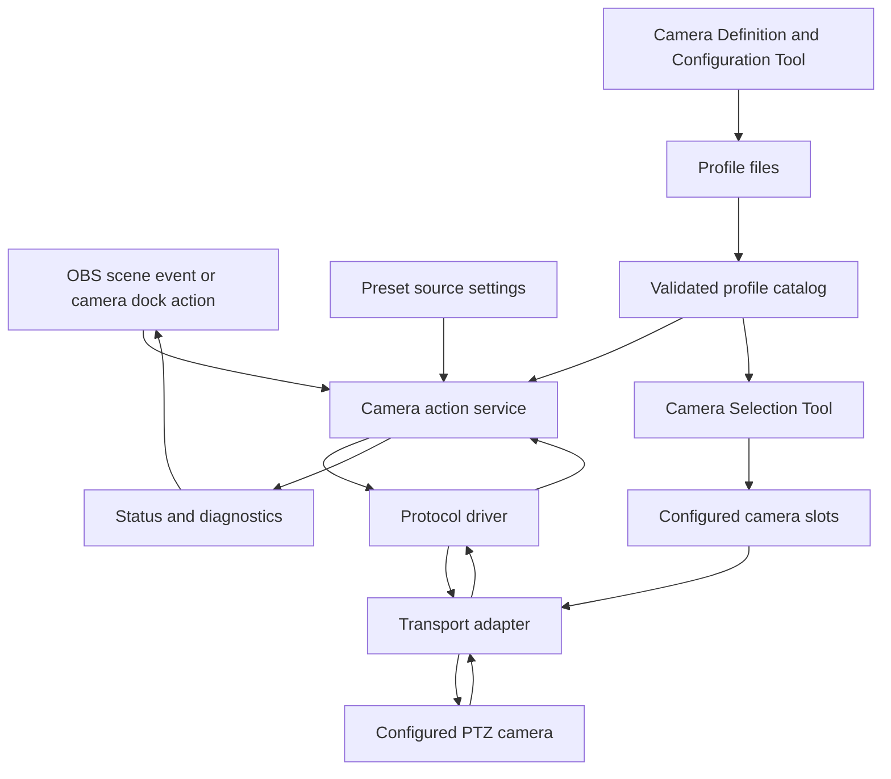

# Project map

## Functional boundary

SimpleCam Direct should own the scene action and the physical-camera command path. OBS remains the host for scenes, sources, preview/program state, and docks. A camera profile supplies validated model/firmware facts and operation bindings; a protocol driver encodes and interprets a protocol; a transport adapter moves bytes or standardized PTZ requests to the device.

Implementation is staged. The first target is a Windows-only VISCA vertical slice for the AViPAS AV-1280W, before generalized profile authoring, ONVIF, NDI, or external beta expansion. See [`DEVELOPMENT_ROADMAP.md`](DEVELOPMENT_ROADMAP.md).

The existing native SimpleCam OBS plugin is a proven reference for source behavior, but it writes request files for SimpleCamQt to consume. SimpleCam Direct removes that bridge entirely. Its OBS preset sources and camera dock call the same in-process camera action service; neither component sends requests to the other, and there is no source-to-dock or source-to-camera-I/O file protocol.

## Logical components

| Component | Responsibility | Owns |
|---|---|---|
| OBS integration | Register sources, docks, properties, hotkeys, lifecycle callbacks, scene/preview/program events | OBS API boundary and serialized source settings |
| Preset source | Keep the existing OBS source-property workflow; store camera, logical preview number, trigger mode, and delay; request names from the currently selected group for editing; call the shared preview action service | Per-scene source configuration and source-name presentation |
| Controls Dock | Operate configured camera slots: choose the camera shown on each card, move it, recall/store presets, and manage preset groups, names, and visual order; call the same action service as preset sources | Temporary control state, preset names/maps, and floating-appearance preference |
| Camera Selection Tool | Assign a selected reusable profile to one of up to five installation slots; configure that physical camera's network or serial connection and test/retest the connection | Per-install slot assignment and connection details only |
| Profile catalog | Discover JSON and `.camera.cfg` profile files, validate schema and compatibility, de-duplicate ids, expose eligible profiles | Immutable profile records and validation diagnostics |
| Camera Definition and Configuration Tool | Create, edit, duplicate, import, validate, test, save, and export reusable camera profiles, including protocol bindings and an optional ordered startup sequence | Profile drafts, validation results, and explicit test authorization |
| Camera action service | Accept semantic actions (pan, stop, zoom, recall preset, store preset, etc.); preserve ordering and per-camera serialization | Queue, state, cancellation and acknowledgements |
| Protocol drivers | Convert semantic operations to protocol messages and parse responses | VISCA, ONVIF, NDI PTZ, and later protocols as separate adapters |
| Transport adapters | Open/close sockets or serial ports, frame streams/datagrams, report I/O results | TCP, UDP, serial; optional vendor/SDK transport |
| Diagnostics | Correlate UI/source action, profile, driver, transport, request/reply and OBS scene event; show a live send/reply trace during profile tests | Redacted structured logs, transaction trace, and user-readable status |

## Functional flow



This is a logical map, not a threading diagram. The implementation must keep potentially blocking I/O off OBS UI/source callback threads and preserve one ordered command stream per physical camera. Sources and dock controls share that service and queue; there is no inter-component communication layer.

## Main data contracts

1. **Source action:** OBS source id + configured camera id + logical preview number + trigger mode + delay; source callbacks submit it directly to the shared in-process action service. The source does not store a preset group.
2. **Camera action:** a typed operation and parameters, not a raw byte string from UI code. Dock buttons submit the same action types through the same service.
3. **Preset resolution:** while editing a source, the source UI requests the preset-name list for the currently selected Preview Group. At runtime it passes its saved 1–14 preview number to the preview action; that action reads the currently selected Preview Group and resolves the physical slot from that camera's page map. The default sequential map uses `Preview + ((Preview Group - 1) * 14)`, so group 2, Preview 1 recalls physical preset 15. A custom page map can distribute physical presets differently while keeping the source independent of the mapping.
4. **Preset capacity and pages:** the selected camera profile supplies the usable preset capacity. There is no per-camera capacity override: if a model/firmware variant needs different capability data, it uses a distinct profile. Start with five 14-slot pages. The existing top `PG` button cycles through pages; do not add selector radio buttons. In Settings, `+` and a trash icon sit beside the active page-description field to add or remove a page. Trash is enabled only when all 14 button labels on that page are blank and at least five pages will remain. A page map assigns physical presets to button slots; unassigned/out-of-capacity slots are disabled, dimmed, and labeled `---`. Clearing a button blanks its label without erasing the camera's stored preset. Control mode offers Set/Rename; Settings offers Swap/Clear/Rename. The maximum page count is the greater of five or the number needed to expose the profile's capacity at 14 slots per page. A 25-preset model may distribute those 25 mappings across any of the five default pages. A 255-preset model can use 19 pages (18 full pages and 3 presets on the last page).
5. **Initial action set:** home, four-direction pan/tilt, zoom in/out and absolute zoom, preset store/recall, focus auto/manual and near/far, white balance auto/manual, backlight behavior, and camera power/standby. See `CAMERA_ACTION_CONTRACT.md` for speed and protocol boundaries.
6. **Profile:** model-specific metadata, supported capabilities, protocol bindings, transport variants, value constraints, optional startup sequence, evidence, and verification status. Profiles are reusable model definitions; any behavior exception is a separate profile.
7. **Transport result:** accepted/sent, protocol acknowledgement, completion or result, timeout, rejection, or transport failure.
8. **Diagnostic event:** timestamp, correlation id, camera/profile id, operation, layer, result, and redacted details.
9. **Profile edit:** base profile id/version + draft changes + validation state. A draft is not active until it passes validation and the user applies it to an installation slot.
10. **Startup sequence:** an optional ordered profile sequence runs when the selected camera's connection becomes ready and after reconnect. It uses validated driver operations, explicit state-setting commands, and the normal per-camera queue; results appear in the Camera Selection Tool's sent/reply diagnostics. A user can explicitly rerun it. It does not add controls to the Controls Dock.

## Target repository map

```text
AGENTS.md
README.md
docs/
  PROJECT_MAP.md
  BEHAVIOR_CONTRACT.md
  ARCHITECTURE.md
  CAMERA_PROFILE_REVIEW.md
  CAMERA_PROFILE_EDITOR.md
  CAMERA_ACTION_CONTRACT.md
  PROFILE_VARIABLES.md
  PROTOCOL_EVOLUTION.md
  UI_THEMING.md
  DEVELOPMENT_ROADMAP.md
  SIMPLECAMQT_PARITY_CHECKLIST.md
  PLATFORM_TEST_CHECKLIST.md
  FORK_AND_AGENT_CONTRIBUTIONS.md
  PULL_REQUEST_EVIDENCE_TEMPLATE.md
  USER_GUIDE.md
schemas/
  camera-profile.schema.json
data/cameras/
  <manufacturer>-<model>.camera.cfg
src/
  obs/                 # OBS source/dock integration
  actions/              # typed camera actions and scheduling
  profiles/             # catalog, parser, validator
  drivers/              # protocol-specific encoding/decoding
  transports/           # TCP, UDP, serial and optional SDK adapters
tests/
  profiles/
  protocol/
  source-settings/
```

This layout is a starting map. Match the OBS plugin template's real build structure when implementation starts; do not force the template into this tree if it harms its build/package conventions.

## Current first-pass code map

The initial implementation follows the OBS plugin template layout while keeping the camera path compact. The current Cameras dock is a first-sprint connection form; the planned Camera Selection Tool and Camera Definition and Configuration Tool are future OBS Tools windows:

| Path | Current responsibility |
|---|---|
| `src/plugin-main.cpp` | OBS module lifecycle, dock registration, and Program/Preview scene-change dispatch |
| `src/preset_source.cpp` | Distinct `simplecamdirect_preset` source, source properties/name refresh, and ordered scene-item dispatch |
| `src/camera_docks.cpp` | Current Camera Control and interim Cameras Qt docks, preset-page editing, movement buttons, and initial connection form |
| `src/camera_runtime.cpp` / `.hpp` | Persistent camera/preset settings, logical-to-physical mapping, asynchronous TCP queue, and semantic camera actions |
| `src/visca_packets.hpp` | Initial AViPAS-target VISCA packet builders |
| `tests/visca_packets_test.cpp` | Byte-for-byte packet fixtures runnable without OBS |

This is the 0.1.0 Windows vertical slice, not yet the future multi-profile architecture described above. Windows compilation, OBS runtime behavior, and real-camera behavior still require the maintainer's test machine and AViPAS camera.

## Deliberate boundaries

- Profiles declare what a model supports; drivers implement protocol semantics. JSON must not become a second programming language.
- Protocol driver selection must come from an explicit profile/connection choice and validated support, not guessed from an IP port.
- User connection data belongs to the user's OBS configuration, not the shared camera catalog or reusable model profile.
- Shipped manufacturer profiles are read-only in the editor. Customizations are saved as user profiles; Save As always creates a new stable profile id and never silently replaces the source profile.
- There is one reusable profile format for built-in, manufacturer-submitted, and user-created profiles. A custom variant is a distinct profile with its own id (for example, AViPAS 1280X), not a per-unit capability override. Each physical camera slot stores its selected profile id and private connection settings separately.
- The profile format may contain an optional ordered startup sequence for supported model-specific setup that is outside SimpleCam Direct's regular action controls. Startup commands are declarative and driver-validated, run on connection readiness/reconnect, and set explicit states rather than toggle. They use the same serialized camera action/transport path and expose sent/reply results.
- The profile editor may assemble only declared, typed operations and supported driver parameters. It must not become a general script editor or allow arbitrary code, shell execution, or user-supplied network destinations.
- Named preset source behavior should not be coupled to camera card layout, so a dock can be changed without breaking saved scenes.
- Device discovery and source-name refresh are independent from camera motion; failure to refresh labels must not accidentally trigger a move.

## Remaining design decisions for later milestones

- Which profile directories are built-in and user-writable on each OS; define precedence and duplicate-id rules across catalog sources.
- Exact structured schema for VISCA multi-step command sequences and startup steps, including ACK/completion barriers, repeat-safe state-setting behavior, and per-step parameter constraints.
- Which command operations require a query/ack before proceeding and which can safely be fire-and-forget.
- Whether NDI SDK integration is included in the base package or offered as an optional build feature.
- How the upstream workflow stores a fork-local `AGENTS.md` addendum so contributors can maintain local instructions while submitting only generally useful policy changes upstream.
