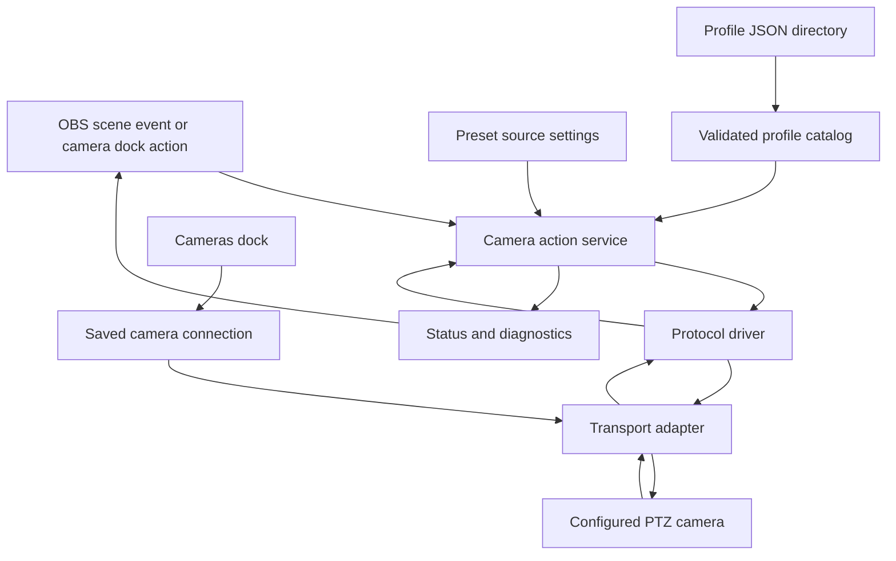

# Project map

## Functional boundary

SimpleCam Direct should own the scene action and the physical-camera command path. OBS remains the host for scenes, sources, preview/program state, and docks. A camera profile supplies validated model/firmware facts and operation bindings; a protocol driver encodes and interprets a protocol; a transport adapter moves bytes or standardized PTZ requests to the device.

Implementation is staged. The first target is a Windows-only VISCA vertical slice for the AViPAS AV-1280W, before generalized profile authoring, ONVIF, NDI, or external beta expansion. See [`DEVELOPMENT_ROADMAP.md`](DEVELOPMENT_ROADMAP.md).

The existing native SimpleCam OBS plugin is a proven reference for source behavior, but it writes request files for SimpleCamQt to consume. SimpleCam Direct removes that bridge entirely. Its OBS preset sources and camera dock call the same in-process camera action service; neither component sends requests to the other, and there is no source-to-dock or source-to-camera-I/O file protocol.

## Logical components

| Component | Responsibility | Owns |
|---|---|---|
| OBS integration | Register sources, docks, properties, hotkeys, lifecycle callbacks, scene/preview/program events | OBS API boundary and serialized source settings |
| Preset source | Keep the existing OBS source-property workflow; store camera, preset group, logical preset/button position, trigger mode, and delay; resolve the selected group/map and call the shared action service | Per-scene source configuration and source-name presentation |
| Camera Control dock | Provide SimpleCamQt-style live controls and preset buttons; Settings mode retains preset naming and visual button swapping; call the same action service as preset sources | Temporary control state, preset names/maps, and floating-appearance preference |
| Cameras dock | Add/edit/disable cameras, select profile and communication protocol, configure endpoints and serial parameters, validate settings, and test a connection | Per-install camera configuration |
| Profile catalog | Discover JSON and `.camera.cfg` profile files, validate schema and compatibility, de-duplicate ids, expose eligible profiles | Immutable profile records and validation diagnostics |
| Profile editor | Inspect and customize a profile in a draft workspace, validate typed command sequences, test against a selected camera, save user profiles or Save As | Draft edits, validation results, and explicit test authorization |
| Camera action service | Accept semantic actions (pan, stop, zoom, recall preset, store preset, etc.); preserve ordering and per-camera serialization | Queue, state, cancellation and acknowledgements |
| Protocol drivers | Convert semantic operations to protocol messages and parse responses | VISCA, ONVIF, NDI PTZ, and later protocols as separate adapters |
| Transport adapters | Open/close sockets or serial ports, frame streams/datagrams, report I/O results | TCP, UDP, serial; optional vendor/SDK transport |
| Diagnostics | Correlate UI/source action, profile, driver, transport, request/reply and OBS scene event; show a live send/reply trace during profile tests | Redacted structured logs, transaction trace, and user-readable status |

## Functional flow



This is a logical map, not a threading diagram. The implementation must keep potentially blocking I/O off OBS UI/source callback threads and preserve one ordered command stream per physical camera. Sources and dock controls share that service and queue; there is no inter-component communication layer.

## Main data contracts

1. **Source action:** OBS source id + configured camera id + preset group + logical preset/button position + trigger mode + delay; source callbacks submit it directly to the shared in-process action service.
2. **Camera action:** a typed operation and parameters, not a raw byte string from UI code. Dock buttons submit the same action types through the same service.
3. **Preset resolution:** a preset source stores its group and logical button position. The service resolves the group's visual map to a physical camera slot; with the default 14-button mapping, group 2/button 1 resolves to physical preset 15. Visual swaps change the mapping, not the camera's stored presets.
4. **Initial action set:** home, four-direction pan/tilt, zoom in/out and absolute zoom, preset store/recall, focus auto/manual and near/far, white balance auto/manual, backlight behavior, and camera power/standby. See `CAMERA_ACTION_CONTRACT.md` for speed and protocol boundaries.
5. **Profile:** model-specific metadata, supported capabilities, protocol bindings, transport variants, value constraints, evidence, and verification status.
6. **Transport result:** accepted/sent, protocol acknowledgement, completion or result, timeout, rejection, or transport failure.
7. **Diagnostic event:** timestamp, correlation id, camera/profile id, operation, layer, result, and redacted details.
8. **Profile edit:** base profile id/version + draft changes + target camera/connection variant + validation state. A draft is not active until it passes validation and the user applies it.

## Target repository map

```text
AGENTS.md
README.md
docs/
  PROJECT_MAP.md
  BEHAVIOR_CONTRACT.md
  ARCHITECTURE.md
  CAMERA_PROFILE_REVIEW.md
  CAMERA_PROFILE_EDITOR.md
  CAMERA_ACTION_CONTRACT.md
  PROFILE_VARIABLES.md
  PROTOCOL_EVOLUTION.md
  UI_THEMING.md
  DEVELOPMENT_ROADMAP.md
  SIMPLECAMQT_PARITY_CHECKLIST.md
  PLATFORM_TEST_CHECKLIST.md
  FORK_AND_AGENT_CONTRIBUTIONS.md
  PULL_REQUEST_EVIDENCE_TEMPLATE.md
  USER_GUIDE.md
schemas/
  camera-profile.schema.json
data/cameras/
  <manufacturer>-<model>.camera.cfg
src/
  obs/                 # OBS source/dock integration
  actions/              # typed camera actions and scheduling
  profiles/             # catalog, parser, validator
  drivers/              # protocol-specific encoding/decoding
  transports/           # TCP, UDP, serial and optional SDK adapters
tests/
  profiles/
  protocol/
  source-settings/
```

This layout is a starting map. Match the OBS plugin template's real build structure when implementation starts; do not force the template into this tree if it harms its build/package conventions.

## Deliberate boundaries

- Profiles declare what a model supports; drivers implement protocol semantics. JSON must not become a second programming language.
- Protocol driver selection must come from an explicit profile/connection choice and validated support, not guessed from an IP port.
- User connection data belongs to the user's OBS configuration, not the shared camera catalog.
- Shipped manufacturer profiles are read-only in the editor. Customizations are saved as user profiles; Save As always creates a new stable profile id and never silently replaces the source profile.
- There is one reusable profile format for built-in, manufacturer-submitted, and user-created profiles; a custom profile may be intended for one camera but is not a separate override type. Each physical camera instance stores its selected profile id and private connection settings separately.
- The profile editor may assemble only declared, typed operations and supported driver parameters. It must not become a general script editor or allow arbitrary code, shell execution, or user-supplied network destinations.
- Named preset source behavior should not be coupled to camera card layout, so a dock can be changed without breaking saved scenes.
- Device discovery and source-name refresh are independent from camera motion; failure to refresh labels must not accidentally trigger a move.

## Open design decisions to resolve before feature implementation

- New source id versus migration of existing `Camera_Preset2` scene sources.
- Whether preset groups are device-native banks, plugin-side logical labels, or both. Keep logical visual order distinct from physical preset slot numbers.
- Which profile directories are built-in and user-writable on each OS; define precedence and duplicate-id rules across catalog sources.
- Exact profile editor control layout and the final structured schema for VISCA multi-step command sequences, including ACK/completion barriers and per-step parameter constraints.
- Which command operations require a query/ack before proceeding and which can safely be fire-and-forget.
- Whether NDI SDK integration is included in the base package or offered as an optional build feature.
- How the upstream workflow stores a fork-local `AGENTS.md` addendum so contributors can maintain local instructions while submitting only generally useful policy changes upstream.
