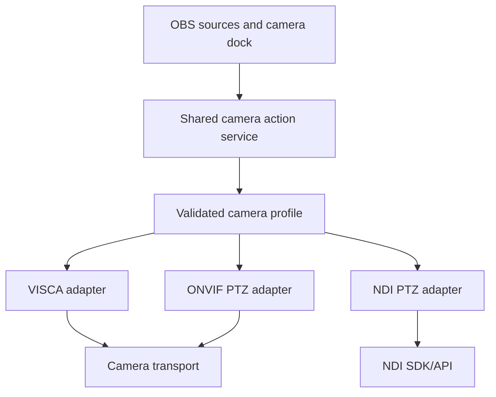

# Protocol implementation and compatibility plan

## Goal

Design the plugin so VISCA, ONVIF, and NDI PTZ can share the same camera actions and OBS integration while keeping their command formats isolated. Implement and verify one protocol at a time. Adding a protocol must not silently reinterpret or change an existing profile.

The first hardware target is the user's AViPAS AV-1280W over the currently working VISCA connection. ONVIF support for that camera is conditional on its firmware exposing the required ONVIF services and PTZ capabilities. NDI PTZ is a later driver phase and is conditional on the selected NDI device/API exposing PTZ control.

This protocol sequence follows the product milestones in [`DEVELOPMENT_ROADMAP.md`](DEVELOPMENT_ROADMAP.md): complete the narrow 0.1.x vertical slice, generic communication engine, VISCA JSON profile, and profile editor/library gates before beginning the ONVIF configuration trial.

## Shared boundary

All protocol drivers implement the same typed camera action contract. OBS sources and the camera dock submit semantic actions such as `panTilt`, `zoom`, `zoomTo`, `presetRecall`, and `focusMode`; they do not construct protocol packets, SOAP, or NDI metadata. Profiles declare the operations and capabilities that a particular connection supports. A driver validates and converts the typed action, then sends it through its transport and returns a structured result.

The adapter is selected by an explicit profile connection variant and user camera configuration, never inferred from the port number or the camera's video transport.

## Incremental implementation phases

### Phase 1 — VISCA baseline

1. Implement the shared action service, profile validation, VISCA driver, and configured transport path.
2. Verify the AViPAS AV-1280W with the exact network/serial VISCA mode and command references used by the user.
3. Cover pan/tilt, stop, home, zoom in/out, absolute zoom if supported, preset store/recall, focus mode/movement, white balance, backlight, power, replies, timeouts, and safe failure behavior according to the device's documented capabilities.
4. Save golden packet/sequence fixtures and hardware-test evidence before starting the next driver.

### Phase 2 — ONVIF PTZ, if supported

1. Check the camera/firmware's ONVIF services, authentication, Media profile token, PTZ configuration/node, and advertised position and speed spaces.
2. Implement a separate ONVIF adapter for the shared PTZ actions the camera exposes. ONVIF uses typed request fields and a SOAP serializer; it does not consume VISCA byte templates.
3. Keep preset and non-PTZ actions disabled unless the ONVIF service and camera explicitly support them and the product contract adds them.
4. Preserve the VISCA profile, parser, formatters, fixtures, and observed behavior unchanged. Run the full VISCA regression suite whenever ONVIF code or shared components change.
5. If the AViPAS does not expose suitable ONVIF PTZ, record that result and test ONVIF on another supported camera before claiming the driver works.

### Phase 3 — NDI PTZ

1. Add a separate NDI PTZ adapter using the appropriate NDI SDK/API and its supported PTZ metadata/control structures.
2. Keep NDI discovery and media capability distinct from PTZ control support; a camera or source carrying NDI video is not automatically PTZ-controllable through NDI.
3. Declare SDK dependency, packaging, and license requirements before making the adapter part of standard builds.
4. Run the VISCA and ONVIF regression suites plus NDI-specific fixtures/hardware tests. An NDI addition must not change either earlier profile's parsing or semantics.

## Variable and command-format evolution

The variable registry and encoders are plugin-owned, typed, and additive. Names are namespaced by meaning or protocol, such as `camera.viscaAddress`, `zoom.position`, `onvif.mediaProfileToken`, and `ndi.ptz.*`. A variable declares its input type, source, allowed semantic actions, valid range, and drivers that may consume it.

- VISCA profiles may use bounded byte templates with fixed literals and registered placeholders/formatters.
- ONVIF profiles use structured PTZ fields and discovered coordinate-space URIs. The adapter serializes SOAP/XML; profile authors do not build arbitrary SOAP from text templates.
- NDI profiles use typed metadata/control fields accepted by the chosen SDK/API. They do not reuse VISCA hex formatters.
- New variables, formatters, and serializers are registered with the relevant adapter and validator. They cannot shadow an existing name or change an existing formatter's meaning.
- A protocol-specific need may add a new typed value or formatter, but it must not turn profiles into scripts or introduce evaluation, loops, conditionals, or user-defined functions.
- Command-template syntax has an explicit version. Omitted version means version 1. A runtime rejects a profile using an unsupported version with a path-specific diagnostic; it does not guess or downgrade.
- Existing VISCA profiles remain valid and produce the same bytes across additive registry changes. Any incompatible VISCA grammar or semantics change requires an explicit migration and updated profile version, plus fixture review.

## Regression gates for every protocol addition

Before merging a new adapter, verify:

1. Existing profile JSON still validates and selects the same driver/connection.
2. Golden VISCA packets and response parsing are byte-for-byte unchanged; hardware smoke tests still pass on the AViPAS.
3. Existing OBS source settings, camera selection, action queue ordering, cancellation, and error reporting are unchanged.
4. The new adapter rejects unsupported actions and out-of-range values without sending partial requests.
5. New variable/formatter names are registered, typed, bounded, documented, and tested at range boundaries and invalid inputs.
6. The Sent/Received trace reports protocol-specific representations without exposing credentials.
7. Platform packaging and runtime dependencies are tested for every supported build target.

Record each phase's support as `draft`, `protocol-reviewed`, or `hardware-tested` per profile and connection variant. A protocol adapter passing unit tests does not mark an individual camera profile hardware-tested.
